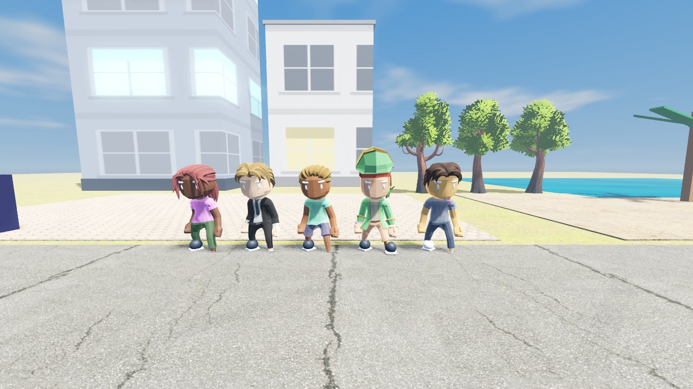
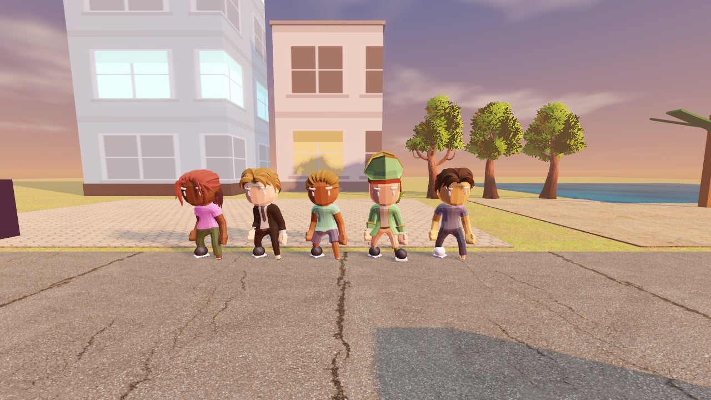
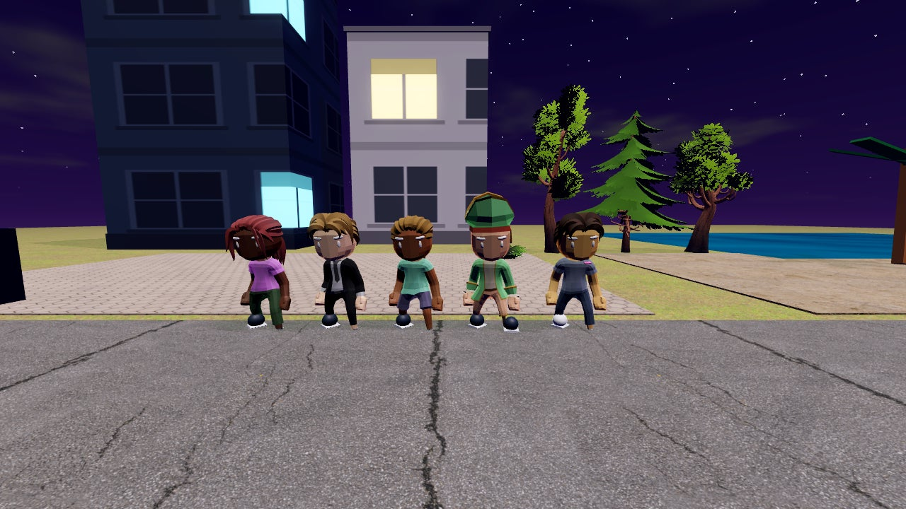

# AURA CITY

Ein 3D-Open-World-Spiel (Godot 4.3, GDScript): Lauf durch eine riesige Stadt, zieh an deiner
(erfundenen) Vape, blas Wolkenformen mit Timing, baue Combos und Ketten, farme Aura, steig im Rang auf und schalte Distrikte, Wolken und Kosmetik frei.

| Tag | Abend | Nacht |
|---|---|---|
|  |  |  |

<sub>Lab-Szene, Software-Rendering (llvmpipe) – auf echter Hardware mit Kantenglättung schärfer.</sub>

> Satire-Hinweis: Die „Gadgets“ sind rein kosmetische Fantasie-Objekte mit bunten Wolken-Effekten.
> Es gibt keine Inhalations- oder Nikotin-Mechanik.

## Features

- **Echte Figuren:** Quaternius-Stadtfiguren (CC0) mit über 45 retargeteten Animationen
  (Laufen, Sprinten, Springen, Tanzen, Rollen, Spells …). Outfit bestimmt den Körper (männlich/weiblich wählbar),
  Frisuren werden von anderen Figuren übernommen, Accessoires/Schuhe/Gadget hängen an Knochen.
- **Lebendige Stadt:** Passanten auf den Gehwegen, dampfende NPCs (Ringe, Ghosts) und Reaktionen,
  Verkehr auf der Ringstraße (Autos bremsen vor dir), geparkte Autos, Laternen, Parks.
- **Grafik:** PBR-Texturen (Poly Haven), Bäume/Büsche/Steine (Quaternius), eigener Himmels-Shader
  mit Sonne, Wolken, Abendrot und Sternen, animiertes Wasser, Tag/Nacht mit Farbverläufen,
  Grafik- und Effekt-Qualitätsstufen.
- **Hoverboards (Q)** in 6 Stufen (12–25 m/s) für die große Map.
- **Aura-Kiosk (N):** 7 fiktive Drinks (Limo, Mate, Shakes …) mit zeitlichen Boosts – serverseitig geprüft.
- **Aura-Battles:** 8 NPC-Rivalen fordern dich heraus.
- **Foto-Modus (P):** Zeit anhalten, frei fliegen, Screenshots speichern.
- **Distrikt-Musik:** eigene prozedurale Themes pro Distrikt mit Überblendung.

- **Riesen-Map (900 × 900 m)** mit 9 Distrikten: Spawn City, Skate Park, Neon District, Luxury District,
  Hafen, Sunset Beach, Graffiti Yard, Downtown Skyline und eine geheime Dimension. Dazu Straßennetz mit Ring,
  Vororte, Teleporter-Hub am Spawn und eine Minimap.
- **12 Wolkenformen** (Kleine Wolke, O-Ring, Ghost … Wolkenkratzer) mit Zug-Leiste (Perfect/Good, daneben = Husten und Aura weg), Combos bis ×6, benannten Ketten,
  Meisterschaft (5 Stufen) und Freischaltung über Lifetime-Aura.
- **Aura-Wirtschaft:** 8 Ränge (NPC → Beyond Reality), Level, Aura/min, Aura Rush alle 5 Minuten,
  Tagesbelohnung mit 7-Tage-Serie.
- **Shop & Inventar:** 61 Items in 11 Kategorien und 7 Raritäten, Suche, Filter, 3D-Vorschau,
  Kaufbestätigung, Garderobe mit Live-Vorschau.
- **Quests & Erfolge:** tägliche/wöchentliche Quests, 14 Erfolge (auch geheime).
- **21 Challenges** (Perfects / Combo / Score), **63 Aura-Splitter**, davon 7 geheim und teils nur durch Klettern erreichbar.
- **Online-Modus mit server-autoritativer Aura (Anti-Cheat)** und Online-Bestenliste. Ein Offline-Modus mit lokalem Spielstand ist ebenfalls dabei.
- Komplettes UI: Hauptmenü, HUD, Shop, Inventar, Garderobe, Wolkenbuch, Quests, Erfolge, Einstellungen,
  Bestenliste, Pause, Tagesbelohnung, Dialoge, Toasts, Tutorial, Ladebildschirm.
- Musik und Soundeffekte prozedural erzeugt; 3D-Assets und Texturen CC0 (siehe [assets/CREDITS.md](assets/CREDITS.md)).

## Steuerung

| Taste | Aktion |
|---|---|
| WASD / Pfeile | Laufen (Shift = Sprinten) |
| Maus | Kamera |
| Leertaste | Springen |
| 1–4 | an der Vape ziehen |
| F / Linksklick | ausatmen (im Timing-Fenster) |
| E | Interagieren (Shops, NPCs, Schilder, Teleporter, Challenges) |
| G | Emote |
| Q | Hoverboard auf/ab (Shift = Boost) |
| N | Aura-Kiosk (Drinks) |
| P | Foto-Modus (Enter = Foto) |
| B / I / C / K / J / O / L | Shop / Inventar / Garderobe / Wolkenbuch / Quests / Erfolge / Bestenliste |
| Esc | Pause / Menü schließen |

## Plattformen

Windows, Linux, Android (APK) und iOS (unsignierte IPA für AltStore/SideStore) – alle Downloads im GitHub-Release.
Auf Touch-Geräten erscheint automatisch die Touch-Steuerung.

## Starten

```bash
godot --path . --import      # einmalig
godot --path .               # Spiel
```

**Online spielen:** Im Hauptmenü die Server-Adresse eintragen und auf „Online spielen“ klicken.
- Im Heimnetz: `http://auracity.local`
- Über Tailscale: `http://100.126.128.24/auracity`

Beim ersten Verbinden legt der Server ein frisches Profil an. Das Token liegt in `user://net.json`.

## Server

Der Server liegt in `server/`: Node.js ohne externe Abhängigkeiten, gespeichert wird in einer JSON-Datei.
Details zum Anti-Cheat-Modell stehen in [DEVELOPMENT.md](DEVELOPMENT.md).

```bash
cd server && node server.js                 # PORT=3710, DATA_DIR=./data, ADMIN_KEY=…
docker compose up -d --build                # oder als Container
```

## Tests

```bash
godot --headless -- --tests                         # 84 Godot-Tests (Wirtschaft, Shop, Speichern, Tricks, Szene, Map)
cd server && node --test test/game.test.js          # 16 Server-Tests (Regeln + Anti-Cheat)
godot --headless -- --online-test http://127.0.0.1:3710   # End-to-End gegen laufenden Server
godot --headless -- --smoke                         # startet das echte Spiel und öffnet jedes Menü
xvfb-run godot -- --lab <ordner>                    # Vorzeige-Szene rendern (Screenshots)
```
